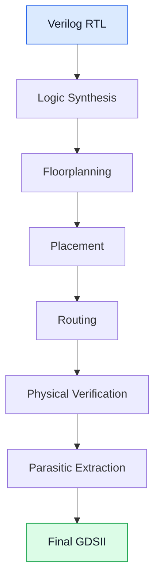

# 6-Tap Symmetric FIR Low-Pass Filter ASIC

### RTL Design | Functional Verification | ASIC Physical Implementation | RTL-to-GDSII

<p align="center">
  
</p>

<p align="center">
  
  
  
  
  
</p>

---

## Overview

This project presents the design and ASIC implementation of a **6-tap symmetric, multiplierless FIR low-pass filter** intended for signal conditioning in UAV flight command receiver systems.

The design uses a symmetric coefficient structure and shift-and-add arithmetic to reduce hardware complexity by eliminating conventional multiplier blocks.

The complete implementation covers the digital design flow, from Verilog RTL development and functional verification to synthesis, physical design, layout verification, and final GDSII generation.

**Key objective:** Demonstrate a complete RTL-to-GDSII ASIC implementation using an open-source physical design flow and the Sky130A technology platform.

## Design Specifications

| Parameter | Specification |
|---|---|
| Filter Type | FIR Low-Pass Filter |
| Number of Taps | 6 |
| Input Width | 8-bit unsigned |
| Output Width | 13-bit unsigned |
| Coefficients | `{2, 4, 6, 6, 4, 2}` |
| Architecture | Symmetric, Pipelined |
| Arithmetic | Multiplierless Shift-and-Add |
| Adder Architecture | Ripple Carry Adder (RCA) |
| RTL Language | Verilog HDL |
| Functional Simulation | Xilinx Vivado 2024.2 |
| Synthesis | Yosys |
| Physical Design | OpenLane 2 |
| Technology | Sky130A PDK |
| Layout Tool | Magic VLSI |

## FIR Filter Architecture

The filter exploits coefficient symmetry to reduce the number of arithmetic operations.

The coefficient sequence is:

\[
h[n] = \{2,4,6,6,4,2\}
\]

The corresponding filter equation is:

\[
\begin{aligned}
y[n] ={}& 2x[n] + 4x[n-1] + 6x[n-2] \\
        &+ 6x[n-3] + 4x[n-4] + 2x[n-5]
\end{aligned}
\]

Using symmetry:

\[
\begin{aligned}
A &= x[n] + x[n-5] \\
B &= x[n-1] + x[n-4] \\
C &= x[n-2] + x[n-3]
\end{aligned}
\]

The final output becomes:

\[
y[n] = 2A + 4B + 6C
\]

The constant multiplications are implemented using shifts and additions:

- \(2A = A \ll 1\)
- \(4B = B \ll 2\)
- \(6C = (C \ll 2) + (C \ll 1)\)

### Architecture Block Diagram

```mermaid
flowchart LR
    A["8-bit Input x[n]"] --> B["Delay Line / Registers"]
    B --> C["Symmetric Pre-Adders"]
    C --> D["Shift-and-Add Arithmetic"]
    D --> E["RCA Adder Stages"]
    E --> F["13-bit Output y[n]"]

    style A fill:#dbeafe,stroke:#2563eb,color:#111827
    style B fill:#e0e7ff,stroke:#4f46e5,color:#111827
    style C fill:#ede9fe,stroke:#7c3aed,color:#111827
    style D fill:#fef3c7,stroke:#d97706,color:#111827
    style E fill:#dcfce7,stroke:#16a34a,color:#111827
    style F fill:#dbeafe,stroke:#2563eb,color:#111827
```



## RTL Design

The design is implemented using modular Verilog HDL, with individual modules for arithmetic operations, delay elements, and filter integration.

| Module | Description |
|---|---|
| `full_adder.v` | Single-bit full adder |
| `rca_9bit.v` | 9-bit ripple carry adder |
| `rca_12bit.v` | 12-bit ripple carry adder |
| `rca_13bit.v` | 13-bit ripple carry adder |
| `pre_adder.v` | Symmetric input pre-addition |
| `adder_architecture.v` | Shift-and-add arithmetic implementation |
| `shift_register.v` | Input delay-line implementation |
| `fir_filter_top.v` | Top-level FIR filter integration |

The modular structure supports independent verification and simplifies integration into the ASIC implementation flow.

## Functional Verification

Functional simulation was performed using **Xilinx Vivado 2024.2** with a dedicated Verilog testbench.

The testbench checks the filter output against the expected FIR computation for sequential input samples.

### Simulation Waveform

<p align="center">
  
</p>

### Sample Simulation Results

| Input | Simulated Output | Expected Output | Status |
|---:|---:|---:|---|
| 20 | 40 | 40 | PASS |
| 20 | 120 | 120 | PASS |
| 20 | 240 | 240 | PASS |
| 21 | 362 | 362 | PASS |
| 22 | 448 | 448 | PASS |
| 90 | 634 | 634 | PASS |

*These are selected sequential simulation observations, not independent steady-state input/output pairs.*

### Input vs. Output Response

<p align="center">
  
</p>

## ASIC Physical Implementation

The RTL design was taken through an ASIC physical implementation flow using **OpenLane 2** and the **Sky130A PDK**.

The implementation flow includes:

1. RTL preparation and design configuration
2. Logic synthesis using Yosys
3. Floorplanning
4. Placement
5. Clock-tree and routing stages as configured
6. Physical verification
7. Parasitic extraction and final design preparation
8. GDSII generation

### Physical Design Flow



### Final ASIC Layout

<p align="center">
  
</p>

### GDSII Deliverable

The generated layout file is available in the repository:

**[`fir_filter_top.gds`](physical_design/gds/fir_filter_top.gds)**

## Tools and Technologies

| Tool / Technology | Application |
|---|---|
| Verilog HDL | RTL design |
| Xilinx Vivado 2024.2 | Functional simulation |
| Yosys | Logic synthesis |
| OpenLane 2 | ASIC physical design flow |
| Sky130A PDK | Semiconductor technology platform |
| Magic VLSI | Layout viewing and physical design |
| Ubuntu / WSL | Development environment |

## Repository Structure

```text
FIR-Filter-ASIC/
│
├── rtl/
│   ├── full_adder.v
│   ├── rca_9bit.v
│   ├── rca_12bit.v
│   ├── rca_13bit.v
│   ├── pre_adder.v
│   ├── adder_architecture.v
│   ├── shift_register.v
│   └── fir_filter_top.v
│
├── simulation/
│   ├── testbench/
│   ├── simulation_results/
│   ├── waveforms/
│   └── README.md
│
├── synthesis/
│   ├── synthesis_reports/
│   ├── timing_reports/
│   └── README.md
│
├── physical_design/
│   ├── gds/
│   ├── reports/
│   ├── verification/
│   ├── layout/
│   └── README.md
│
├── documentation/
│   ├── architecture/
│   ├── design/
│   ├── methodology/
│   ├── results/
│   └── README.md
│
├── assets/
│   ├── readme-banner.png
│   ├── simulation-waveform.png
│   ├── input-output-response.png
│   └── magic-layout.png
│
├── README.md
├── LICENSE
└── .gitignore
```

## Project Highlights

- Designed a 6-tap symmetric FIR low-pass filter.
- Implemented multiplierless constant multiplication using shift-and-add arithmetic.
- Developed modular Verilog RTL with dedicated arithmetic components.
- Performed functional verification using a custom testbench in Vivado.
- Implemented the ASIC physical design flow using OpenLane 2 and Sky130A.
- Generated a final GDSII layout deliverable.

## Contributors

- **Harshad Jagtap**
- **Suraj Jagtap**
- **Shraddha Jadhav**

## License

This project is licensed under the MIT License. See the [LICENSE](LICENSE) file for details.

---

<p align="center">
  <b>From RTL Design to GDSII — Exploring Digital VLSI and ASIC Implementation.</b>
</p>
